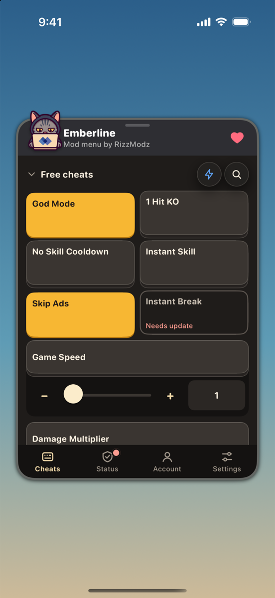
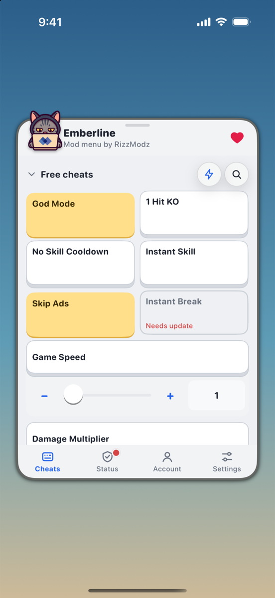
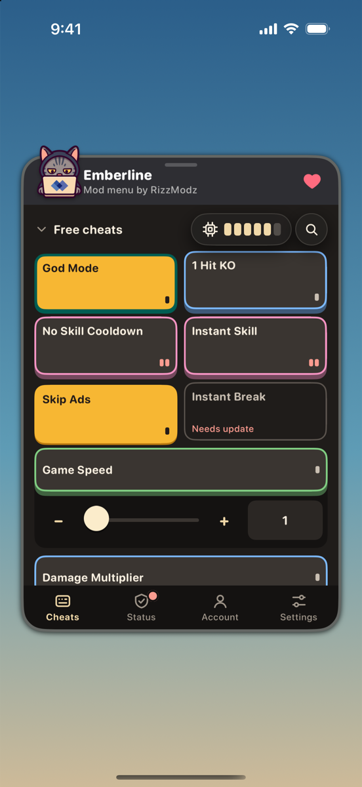
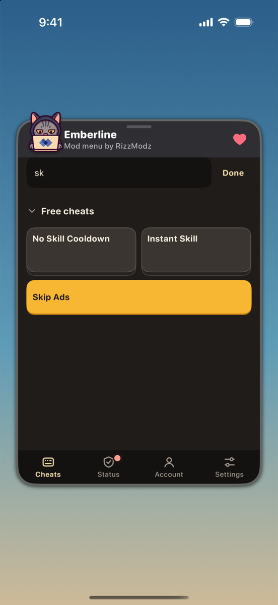
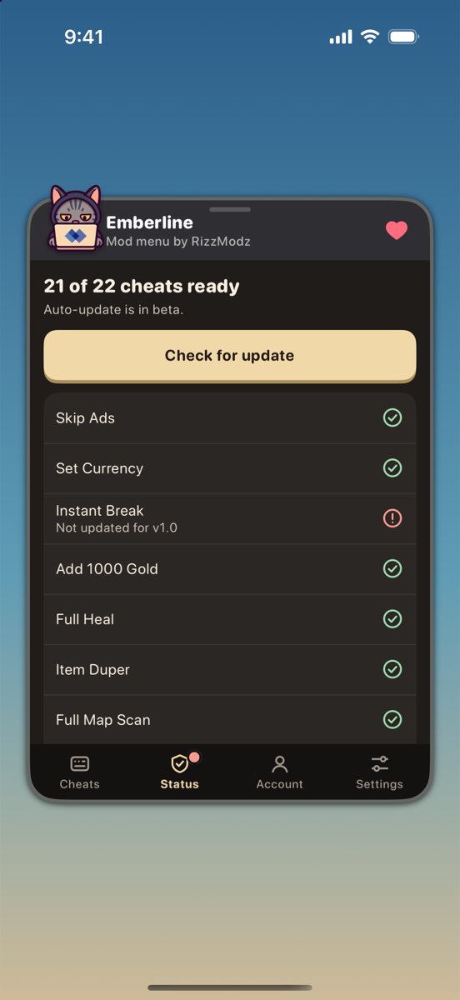
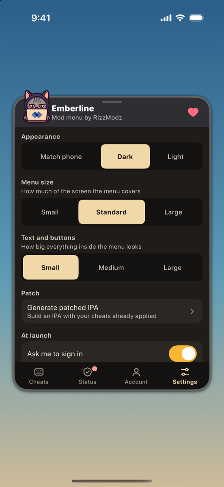
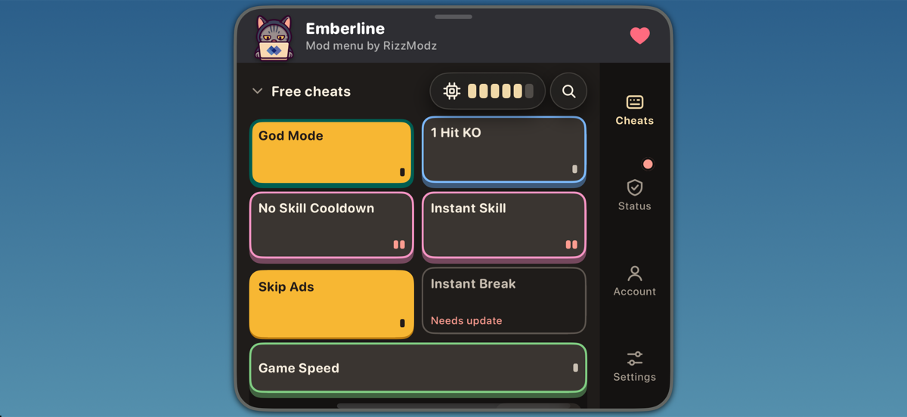

<p align="center">
  
</p>

<h1 align="center">RMz Mod Menu</h1>

<p align="center">
  One mod menu for every supported game, on jailbroken and non-jailbroken iPhone and iPad.
</p>

<p align="center">
  <a href="https://repo.rizzmodz.com/"><b>Jailbroken: add the repo</b></a> ·
  <a href="#non-jailbroken-sideload-feather-esign-sideloadly"><b>Sideload</b></a> ·
  <a href="#non-jailbroken-app-launchers-livecontainer"><b>LiveContainer</b></a> ·
  <a href="../../releases/latest"><b>Latest release</b></a>
</p>

---

## The menu

<table>
  <tr>
    <td align="center"><br><sub>Cheats, dark</sub></td>
    <td align="center"><br><sub>Cheats, light</sub></td>
    <td align="center"><br><sub>Hardware mode: slots and shared sets</sub></td>
  </tr>
  <tr>
    <td align="center"><br><sub>Search</sub></td>
    <td align="center"><br><sub>Status and updates</sub></td>
    <td align="center"><br><sub>Settings</sub></td>
  </tr>
  <tr>
    <td align="center" colspan="3"><br><sub>Landscape</sub></td>
  </tr>
</table>

- **Install once, works everywhere.** RMz Mod Menu works in every supported game. New games and cheat
  fixes arrive from our side, without downloading anything new.
- **Built natively for iPhone and iPad**, with a floating cheat strip and search, Small / Standard / Large
  sizes, and Light, Dark or Match phone appearance.
- **Your RizzModz account.** Sign in from the Account tab; your VIP carries over.

## Jailbroken: add the repo

1. Open **[repo.rizzmodz.com](https://repo.rizzmodz.com/)** on your device and tap **Add to Sileo** or
   **Add to Zebra**, or add this source manually in Sileo, Zebra or Cydia:

   ```
   https://repo.rizzmodz.com/
   ```

2. Install **RMz Mod Menu**. It brings the **RMz Framework** and the **RMz Companion** app with it.
3. Open a supported game and tap the floating button to open the menu.

Rootful and rootless jailbreaks are supported, and your package manager picks the right build. Roothide is
not supported yet. Each package updates on its own from the repo.

**RMz Companion** shows which of your installed apps are supported, lets you turn RMz on or off for each one,
and tells you when an update is available.

## Non-jailbroken: sideload (Feather, ESign, Sideloadly)

You need a **decrypted IPA** of the game and a signing tool that can inject a tweak `.deb`.

1. Download the sideload package:
   **[RMz-Sideload-latest.deb](https://repo.rizzmodz.com/sideload/RMz-Sideload-latest.deb)**
   (or the versioned `RMz-Sideload-<framework>-<menu>.deb` from [Releases](../../releases/latest)).
2. Add the game's IPA to your signing tool and inject the `.deb`:
   - **Feather:** import the IPA, open its signing options, add the `.deb` under **Tweaks**, then sign and install.
   - **ESign:** import the IPA, open **Signature**, add the `.deb` as an injected tweak, then sign and install.
   - **Sideloadly:** drop in the IPA, open **Advanced options**, add the `.deb` to the tweaks to inject, then start.
3. Open the game and tap the floating button to open the menu.

The package carries `RMz.framework` and `RMzModMenu.dylib`. When a new RMz version comes out, re-sign the game
with the new package.

## Non-jailbroken: app launchers (LiveContainer)

For launchers that load tweaks from a folder, such as **LiveContainer**:

1. Download the inject bundle:
   **[RMz-NJB-Inject-latest.zip](https://repo.rizzmodz.com/sideload/RMz-NJB-Inject-latest.zip)**
   (or the versioned `RMz-NJB-Inject-<framework>-<menu>.zip` from [Releases](../../releases/latest)),
   and unzip it. It contains `RMzModMenu.dylib` and `RMz.framework`.
2. In LiveContainer, open the **Tweaks** tab, create a folder (for example `RMz`), and import **both**
   `RMzModMenu.dylib` and `RMz.framework` into it. Keep them side by side in the same folder.
3. Open the game's settings in LiveContainer and set its **tweak folder** to that folder.
4. Launch the game from LiveContainer and tap the floating button to open the menu.

RMz detects LiveContainer and uses the right mode automatically.

## Downloads

| | Where |
|---|---|
| Jailbroken packages | The repo: `https://repo.rizzmodz.com/` |
| Sideload package (`.deb`) | [Latest](https://repo.rizzmodz.com/sideload/RMz-Sideload-latest.deb) · [Releases](../../releases) |
| LiveContainer bundle (`.zip`) | [Latest](https://repo.rizzmodz.com/sideload/RMz-NJB-Inject-latest.zip) · [Releases](../../releases) |

Each release lists a SHA-256 checksum next to every file.

## Support

Report problems in [Issues](../../issues). Include your device, iOS version, jailbreak or sideloading tool,
the game, and your RMz version.
